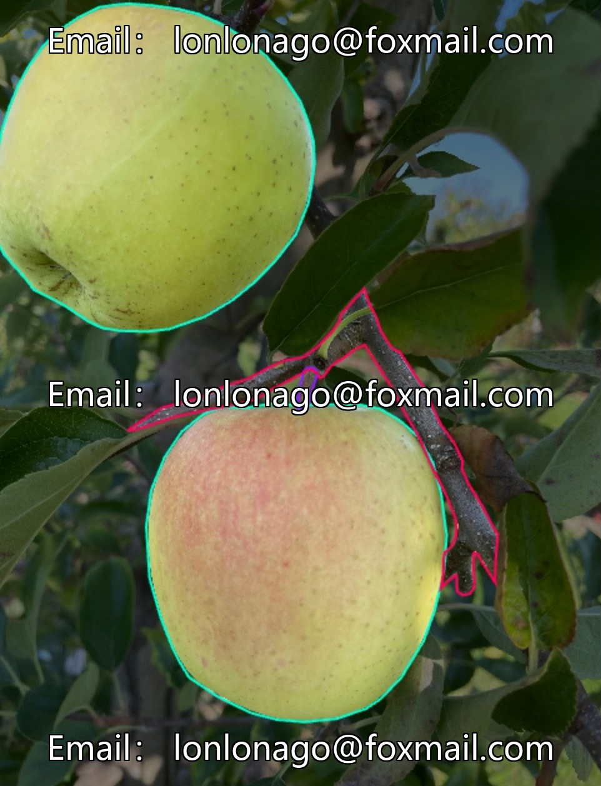
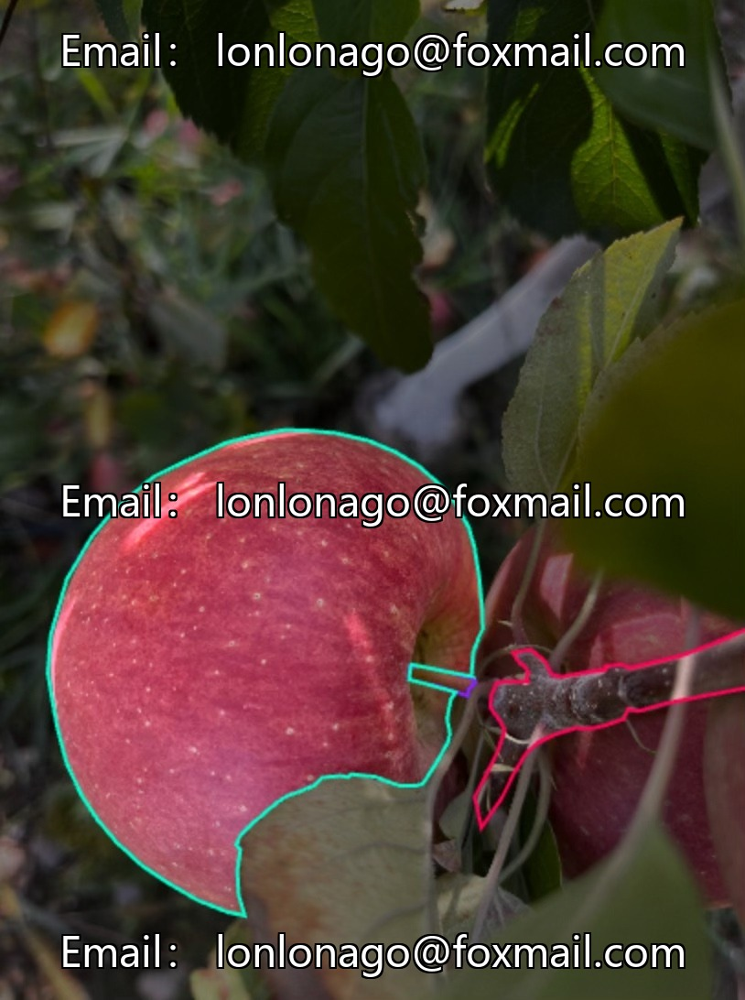
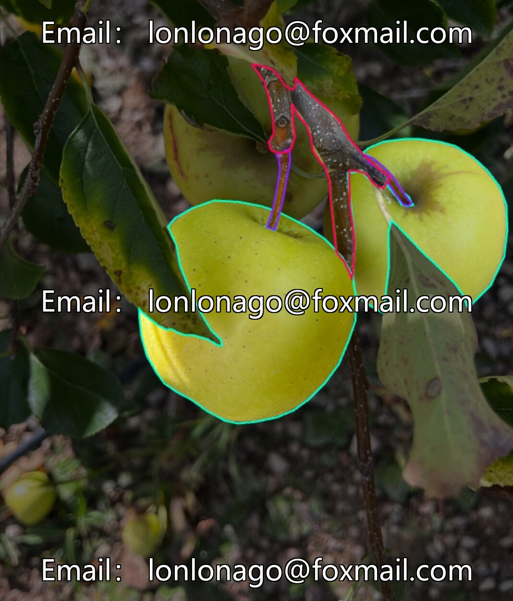
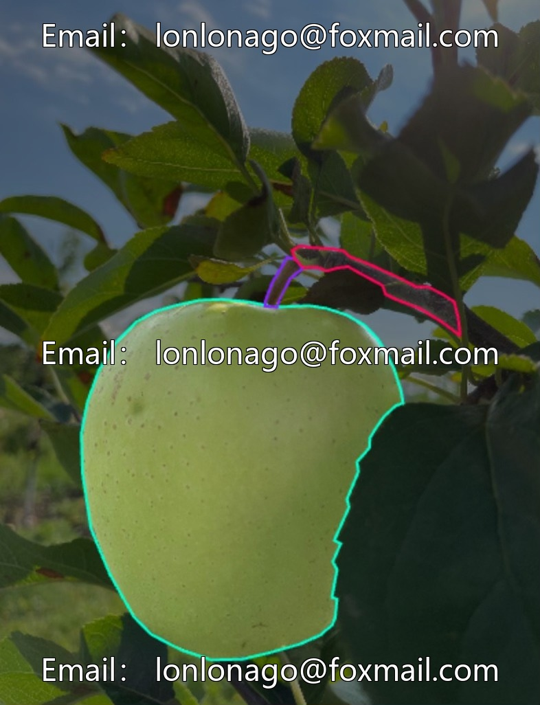
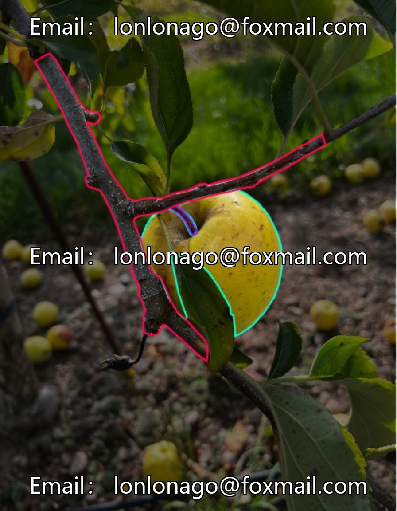
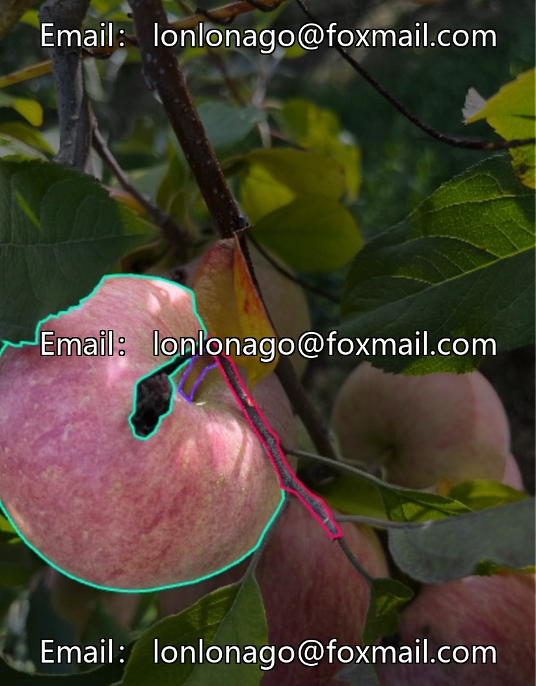

# Apple picking point image recognition dataset based on deep learning YOLO, apple branch segmentation

## Body

Apple picking point image recognition dataset based on deep learning YOLO, apple branch segmentation, apple segmentation detection, apple stem and leaf segmentation recognition, applicable to the development of target recognition algorithms for automated apple picking equipment in orchards.

The dataset consists of 600 images, with three categories of targets (apples, branches, stems), in the YOLO annotation format. It supports training of mainstream computer vision models, which can improve the accuracy of target positioning for harvest robots, optimize sorting efficiency, and assist in growth monitoring.

Virtual materials, once sold, are non-refundable.
Interested friends, click "I want" to proceed.

## Images

## Payment

Here is a pay link on Stripe ( https://buy.stripe.com/3cs8yP7sY87d0vu9AB ). Please contact me lonlonago@foxmail.com after funding $89, and I will send you a complete data files , thank you!

